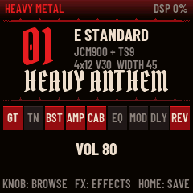
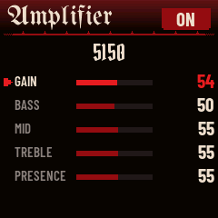
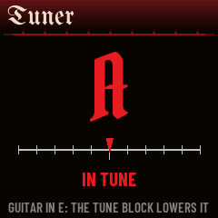

# POCKET METAL: a firmware for metal

POCKET METAL is an alternative firmware for the Donner Pocket X and the M-VAVE BlackBox, made for one kind of music.
It is built on OpenPocket's base firmware ([BASE-FIRMWARE.md](https://github.com/isod89/openpocket/blob/main/docs/BASE-FIRMWARE.md)) and is installed and replaced like any
alternative firmware ([ALT-FIRMWARE.md](https://github.com/isod89/openpocket/blob/main/docs/ALT-FIRMWARE.md)). It is not OpenPocket: the pedal runs one or the other.

It has no NAM. Every amp and pedal is one of OpenPocket's fitted models: a few numbers in a table, found by a computer
so that the model sounds like a capture of the real gear (the method of [FITTED-MODELS.md](https://github.com/isod89/openpocket/blob/main/docs/FITTED-MODELS.md)). Ten
high-gain amps and five pedals were fitted for it. The chain runs on the pedal's second core, the delay and the reverb
on the first, as OpenPocket runs its own engine (section 8).

  

**The first version crackled on a pedal on its heaviest sounds (DOOM CANDLE): the second runs on two cores.** Section
8 lists what was checked and what needs a pedal.

## 1. Install, build, go back

**Install** from the browser: [isod89.github.io/pocket-metal](https://isod89.github.io/pocket-metal/), in Chrome or Edge
on a computer, with the pedal on a USB data cable. The page picks the package for your pedal (Pocket X or BlackBox),
checks it, and installs it over whatever the pedal runs: the official firmware, OpenPocket, or another firmware on
OpenPocket's base. Without internet: `INSTALL.bat` serves the same page on your computer, with the packages you built.

**Build it yourself** (Windows: `BUILD.bat`, with Docker Desktop and Node.js, or WSL). The same from a terminal, on
any system:

```
node tools/op.mjs build     # build/apps/metal/: metal.bin, its two packages, its manifest
node tools/op.mjs test      # the host tests (no pedal)
node tools/op.mjs sim       # the app on this computer: its screen and controls in a page (a C compiler, no Docker)
node tools/op.mjs serve     # the installer on this computer, with the packages just built
```

**The way back** to OpenPocket is OpenPocket's installer, [isod89.github.io/openpocket](https://isod89.github.io/openpocket/):
its install button reads "Back to OpenPocket" while the pedal runs POCKET METAL. Your OpenPocket presets, NAM models and
IRs stay on the pedal meanwhile, and POCKET METAL's own sounds stay through a stay on OpenPocket
([ALT-FIRMWARE.md](https://github.com/isod89/openpocket/blob/main/docs/ALT-FIRMWARE.md), section 4). The way back to the official firmware is step 3 of the installer
page. The recovery paths are OpenPocket's ([ALT-FIRMWARE.md](https://github.com/isod89/openpocket/blob/main/docs/ALT-FIRMWARE.md), section 6).

A BlackBox on M-VAVE's firmware V22 or later is refused, as by OpenPocket ([WHATS-NEW-v43.md](https://github.com/isod89/openpocket/blob/main/docs/WHATS-NEW-v43.md)).

## 2. The controls

| Control | What it does |
| --- | --- |
| The footswitches | The sound before, the sound after, at once. **Both together: the tuner**; the sound stays the one you had. |
| The knob, on the PLAY page | Browses the sounds: the one shown is red and nothing changes. **PUSH loads it.** |
| FX | The pages GATE, TUNE, BOOST and EQ in turn. **Held: the tuner.** |
| MOD, AMP, CAB, DLY, REV | That block's page. Pressed again on its page: the block on or off. |
| On a block page | The knob changes the line marked with a thorn; PUSH marks the next line: the type first, then the settings. |
| HOME | Back to the PLAY page. **Held 0.8 s: SAVE** the sound in its slot. |
| PUSH held 1.2 s, on the PLAY page | The slot's factory sound back (PUSH again within 4 s to confirm). |
| MASTER | The volume. |
| MIDI | Program Change 0 to 59: a sound. Control Change 80 to 88: GATE, TUNE, BOOST, AMP, CAB, EQ, MOD, DELAY, REVERB off (below 64) or on; 89: the tuner. The clock's tempo is shown. |

An edited sound says `EDITED` until it is saved; the next footswitch leaves the edit.

## 3. The sounds

Sixty, at least one for each style of metal. Each one plays at the same loudness on real DI guitar (-23 LUFS, as
OpenPocket's sounds), measured on the bundled DI loops: `python3 tools/metal/level_metal.py --sounds assets/loops/*.wav`
writes `mx_levels.h`. The tuning is the guitar's after TUNE: the guitar itself stays in E.

Sounds 31 to 60 came with the second version. Sounds saved with the first (thirty slots) stay in their slots; the new
slots start on their factory sounds.

| # | Name | Style | Tuning | Amp | Pedal | Cabinet | Effects |
| --- | --- | --- | --- | --- | --- | --- | --- |
| 1 | HEAVY ANTHEM | heavy metal | E | JCM900 | TS9 | 4x12 V30 | plate |
| 2 | TWIN GUITARS | heavy metal (lead) | E, a third above | JCM2000 | | 4x12 GREEN | analog delay, hall |
| 3 | THRASH ATTACK | thrash | E | MARK IV | TS9 | 4x12 V30 | EQ: mids down |
| 4 | BAY AREA | thrash | E | 6505 | TS9 | 4x12 V30 | |
| 5 | SPEED DEMON | speed metal | E | JVM OD2 | M77 | 4x12 GREEN | room |
| 6 | STEEL VALOR | power metal | E | 5150 | | 4x12 V30 | delay, hall |
| 7 | OLD SCHOOL DM | death metal | D | RECTO | DS-1 | 4x12 V30 | |
| 8 | BRUTAL DEATH | death metal | B | 5153 RED | PRECISION | 4x12 V30 | EQ |
| 9 | CHAINSAW | Swedish death | D | JCM900 | HM-2, every knob up | 4x12 V30 | |
| 10 | SWEDE BUZZ | Swedish death | C | GH100 | HM-2 | 4x12 V30 | |
| 11 | NORTHERN COLD | black metal | E | JCM2000 | | 4x12 GREEN | EQ, cathedral |
| 12 | FROSTBITE | black metal (raw) | E | MIG 50 | DS-1 | 1x12 CREAM | hall |
| 13 | FUNERAL HALL | atmospheric black | E | SAVAGE | | 4x12 V30 | tape delay, ambient |
| 14 | DOOM CANDLE | doom | C# | GH100 | M77 | 4x12 GREEN | hall |
| 15 | FUNERAL DOOM | funeral doom | B | ROCKERVERB | | 4x12 GREEN | analog delay, cathedral |
| 16 | SWAMP SLUDGE | sludge | C | MIG 50 | RAT | 4x12 GREEN | |
| 17 | DESERT FUZZ | stoner | D | ROCKERVERB | OS-2 | 4x12 GREEN | spring |
| 18 | DJENT MACHINE | djent | A | YERASOV | PRECISION | 4x12 V30 | EQ |
| 19 | POLYRHYTHM | djent | B | 5153 RED | PRECISION | 4x12 V30 | |
| 20 | PROG ODYSSEY | prog metal | E | SAVAGE | | 4x12 V30 | dual delay, plate |
| 21 | NU GROOVE | nu metal | B | RECTO | | 4x12 V30 | EQ: mids down |
| 22 | BREAKDOWN | metalcore | C | 6505 | PRECISION | 4x12 V30 | |
| 23 | SLAM | deathcore | A | XXX | PRECISION | 4x12 V30 | EQ |
| 24 | BLAST BEAT | grindcore | D | RECTO | UBER METAL | 4x12 V30 | |
| 25 | STEEL FACTORY | industrial | D | 5150 | TS9 | 4x12 V30 | EQ |
| 26 | COWBOY GROOVE | groove metal | Eb | MARK IV | | 4x12 V30 | EQ: mids down |
| 27 | GOTHIC VEIL | gothic | E | JCM900 | | 4x12 GREEN | chorus, cathedral |
| 28 | SYMPHONIC | symphonic | E | SAVAGE | | 4x12 V30 | plate |
| 29 | POST CLEAN | post-metal (clean) | E | TWIN | | 2x12 BLUE | chorus, delay, shimmer |
| 30 | SHRED LEAD | lead | E | JVM OD2 | TS9 | 4x12 V30 | delay, hall |
| 31 | IRON GALLOP | NWOBHM | E | JCM900 | | 4x12 GREEN | plate |
| 32 | SUNSET STRIP | glam metal | E | JCM2000 | TS9 | 4x12 GREEN | chorus, delay, hall |
| 33 | SKATE THRASH | crossover | E | 6505 | DS-1 | 4x12 V30 | room |
| 34 | TEUTONIC | thrash (German) | E | 5150 | M77 | 4x12 V30 | EQ: mids down |
| 35 | TECH SURGEON | technical death | B | 5153 RED | PRECISION | 4x12 V30 | EQ |
| 36 | GOTHENBURG | melodic death | C | 6505 | TS9 | 4x12 V30 | delay, hall |
| 37 | GRAVE BLOOM | death-doom | B | RECTO | M77 | 4x12 GREEN | analog delay, hall |
| 38 | MONOLITH | drone | A | ROCKERVERB, gain 75 | OS-2 | 4x12 GREEN | ambient |
| 39 | DAWN SHROUD | blackgaze | E | JCM2000 | | 4x12 GREEN | tape delay, shimmer |
| 40 | GREY WINTER | depressive black | E | MIG 50 | DS-1 | 1x12 CREAM | cathedral |
| 41 | WAR ASSAULT | war metal | Eb | RECTO | DS-1, gain up | 4x12 V30 | |
| 42 | MEAD HALL | folk metal | E | JVM OD2 | | 4x12 GREEN | EQ: mids up, hall |
| 43 | LONGSHIP | Viking metal | C | 5150 | TS9 | 4x12 V30 | hall |
| 44 | BAROQUE FIRE | neoclassical | Eb | JCM2000 | TS9 | 4x12 GREEN | delay, hall |
| 45 | CHAOS THEORY | mathcore | D | 5150 | PRECISION | 4x12 V30 | |
| 46 | DREAM DROP | alternative metal | B | RECTO | | 4x12 V30 | chorus, plate |
| 47 | D-BEAT | crust | D | JCM900 | HM-2 | 4x12 V30 | |
| 48 | EPIC CRYPT | epic doom | Eb | JCM900 | TS9 | 4x12 GREEN | cathedral |
| 49 | FADING SKY | melodic metalcore | C | 6505 | PRECISION | 4x12 V30 | dual delay, plate |
| 50 | THALL ABYSS | thall | F# | YERASOV | PRECISION | 4x12 V30 | EQ, ambient |
| 51 | SMOKE RITUAL | stoner doom | C | ROCKERVERB | OS-2 | 4x12 GREEN | spring |
| 52 | BAYOU BURN | Southern sludge | D | JCM900 | RAT | 4x12 GREEN | |
| 53 | BOUNCE | nu metal | A | RECTO | | 4x12 V30 | EQ: mids down |
| 54 | EUROPOWER | power metal | E | SAVAGE | TS9 | 4x12 V30 | delay, hall |
| 55 | LABYRINTH | prog metal | Eb | MARK IV | | 4x12 V30 | dual delay, plate |
| 56 | ORTHODOX | dissonant black | Eb | RECTO | | 4x12 V30 | EQ, cathedral |
| 57 | CYBER PULSE | industrial | B | 6505 | PRECISION | 4x12 V30 | flanger |
| 58 | OCTAVE CRUSH | doom | E, an octave below | GH100 | OS-2 | 4x12 GREEN | hall |
| 59 | CRYSTAL CLEAN | clean | E | TWIN | | 2x12 BLUE | chorus, delay, hall |
| 60 | WHAMMY SCREAM | lead | E, an octave above | 5150 | TS9 | 4x12 V30 | delay, hall |

The gate is on in every sound, set for its style: from a light one on the cleans to a hard, fast one on djent and
deathcore. It is made for palm-muted riffs:

- It opens when the guitar passes THRESH, over half a millisecond: the pick's attack stays whole, without a click.
- It stays open while the guitar is above THRESH less 3 dB, then 40 ms more: a note that decays near the threshold
  does not chatter, and a short stop between two chugs does not cut the second one.
- Then it closes at the speed of RELEASE.

`python3 tools/metal/demo.py build/metal-demo` plays the sixty, one after the other, on the bundled DI loops
(`... build/metal-demo 31 60`: the new ones only).

## 4. The amps and pedals

Ten amps and five pedals are new, fitted for POCKET METAL to captures of the Neural Amp Modeler community collection
([pelennor2170/NAM_models](https://github.com/pelennor2170/NAM_models), GNU GPL v3), on real DI guitar
([Alec-Wright/Automated-GuitarAmpModelling](https://github.com/Alec-Wright/Automated-GuitarAmpModelling), GNU GPL v3).
OpenPocket's eight fitted amps and four pedals are there too.

"Spectrum" is the RMS difference of the long-term spectra in 1/6 octaves against the capture, on 20 s of guitar the
fit never heard (below about 1.5 dB the tone is hard to tell apart); "before" is the row the fit started from.

| On the pedal | Capture (author) | Started from | Spectrum (dB) |
| --- | --- | --- | --- |
| RECTO | Bugera 1990, lead channel: a Rectifier-style amp (Phillipe P) | 5150 | 5.5 → **0.8** |
| 6505 | Peavey 6505+, red channel (Helga B) | 5150 | 4.2 → **1.1** |
| 5153 RED | 5150 III, red channel (Helga B) | 5150 | 3.6 → **1.4** |
| XXX | Peavey XXX with KT77 tubes (Helga B) | 5150 | 4.2 → **1.0** |
| SAVAGE | Engl Savage, an Axe-Fx II model (Tom C) | 5150 | 9.2 → **2.7** |
| ROCKERVERB | Orange Rockerverb, an Axe-Fx II model (Tom C) | JCM2000 | 4.2 → **1.5** |
| GH100 | Laney GH100S, high channel (Phillipe P) | JCM900 | 10.0 → **1.5** |
| MIG 50 | Sovtek MIG-50 (Mikhail K) | JCM900 | 3.6 → **2.1** |
| YERASOV | Yerasov, set for Meshuggah (Roman A) | 5150 | 2.9 → **2.8** |
| JVM OD2 | Marshall JVM, OD2 red (Phillipe P) | JCM2000 | 4.7 → **0.9** |
| PRECISION | Precision Drive, the tight boost of modern metal (Phillipe P) | TS9 | 12.1 → **1.7** |
| DS-1 | Boss DS-1, gain up (Keith B) | M77 OD | 14.5 → **2.3** |
| RAT | a RAT-style distortion, mid boost (Helga B, "PP Rot") | M77 OD | 10.4 → **2.0** |
| OS-2 | Boss OS-2 (Helga B) | M77 OD | 4.5 → **3.2** |
| UBER METAL | Line 6 Uber Metal, "insane" (Jason Z) | SWEDE HM-2 | 6.8 → **2.5** |

The fits' results are kept in `tools/metal/fits/`; `tools/metal/mk_rows.py` turns them into the engine's rows
(`engine/px_metal_*.h`), and `tools/metal/level_metal.py` sets their levels as OpenPocket's (`tools/calib_levels.py`).
The cabinets are OpenPocket's: the 4x12 V30 is fitted to measured cabinets, the others are voiced.

## 5. TUNE: down-tuning

The TUNE page's DOWN TUNE lowers the whole guitar by 0 to 10 semitones or by an octave, the low string named as a
guitarist names it: E, Eb, D, C#, C, B, Bb, A, Ab, G, F# STANDARD, E an octave down. It is OpenPocket's aligned
pitch shifter at an exact ratio (`tests/metal/test_metal.c`: every step within 3 cents). MIX below 100 blends the
guitar back in. The guitar stays tuned to E; the tuner reads it as it is. The same page offers the OCTAVER (doom),
the HARMONIZER (twin leads), WHAMMY and DETUNE.

## 6. The stereo stage

POCKET METAL's sound has a left and a right side. A metal rhythm guitar is recorded twice and panned hard; one take
through a pedal can only imitate that, and WIDTH (the last line of the CAB page) sets how much:

- WIDTH 0: the same sound on both sides.
- Above it, the two sides' highs go through two different chains of all-pass filters (second order, at 300, 900, 2500
  and 6000 Hz on the left, between them on the right). Each side keeps every frequency at its level and neither comes
  earlier: only the phases differ, which the ear hears as width. The guitar stays in the middle and never moves.
- Below about 150 Hz both sides stay the same: the low end stays tight in the middle.
- Nothing changes with time (a first version moved the two sides' delays slowly, and the guitar wandered from side to
  side: heard on the first demo, replaced).

## 7. The screens

Black iron and blood: a blackletter for the names and numbers (rendered from Pirata One), a Fraktur for the titles
(UnifrakturMaguntia), a condensed sans for what must be read at a glance (Barlow Condensed). All three are SIL Open
Font License fonts, kept with their licences in `assets/metal/fonts/`; `tools/metal/mkfont_metal.py` makes the
bitmaps (`firmware/apps/metal/mx_fonts.h`).

- **PLAY**: the style and the load; the sound's number, its tuning (or TUNE's other effect: OCTAVER, HARMONIZER,
  WHAMMY, DETUNE), amp, pedal, cabinet and WIDTH; its name; the chain,
  a tile a block, lit when on; `EDITED`, the volume, the MIDI clock's tempo.
- **A block's page**: its title and ON or OFF; its type; a line a setting with a bar; a thorn marks the line the knob
  changes.
- **TUNER**: the note, a scale of ±50 cents with a spike, `IN TUNE` in red.

## 8. Two cores, and what was checked

**Why two cores.** The first version made the whole sound in the audio interrupt, on one core, as OpenPocket's
v34-v36 did. The heaviest sounds came close to the limit there, and DOOM CANDLE crackled on a pedal. The second version
runs POCKET METAL the way OpenPocket runs its engine (`firmware/base/audio_dual.h`, [BASE-FIRMWARE.md](https://github.com/isod89/openpocket/blob/main/docs/BASE-FIRMWARE.md),
section 5):

- the chain (gate, tuning, boost, amp, cabinet, EQ, modulation) and the stereo stage on the second core (CPU1), for a
  whole block;
- the delay and the reverb on the first (CPU0) at the same time, as OpenPocket's wet lanes;
- the screen, the controls and USB on CPU0 outside the interrupt.

If the second core fails to answer, the sound goes on on one core, as in the first version, until the next power-on.

The stereo stage was rewritten to run a whole block a filter at a time: 160 instructions a sample instead of 216, the
same sound (within 1e-5).

**The load.** Instructions a sample on the PC (valgrind; the same proxy as [FITTED-MODELS.md](https://github.com/isod89/openpocket/blob/main/docs/FITTED-MODELS.md)). As a
guide, OpenPocket's v30 sounds counted about 1,800 and showed about 61 % on the pedal.

| Sound | First version, one core | Now, CPU1 | Now, CPU0 (delay, reverb) |
| --- | --- | --- | --- |
| DOOM CANDLE | 2,380 | 1,934 | 397 |
| FUNERAL DOOM | 2,367 | 1,817 | 537 |
| DESERT FUZZ | 2,578 | 2,089 | 440 |
| SLAM | 2,224 | 2,168 | 0 |
| The heaviest now: CYBER PULSE | | 2,194 | 0 |
| All sixty | | 1,361 to 2,194 (1,950 on average) | up to 628 |

CPU1 has nothing else to do and its safety bypass is at 93 %. On one core, if CPU1 is retired, the heaviest sounds
(GRAVE BLOOM, WHAMMY SCREAM: about 2,600) are near the old limit again.

Checked on this computer (`tests/run_tests.sh`, sections base and POCKET METAL):

Checked on this computer (`tests/run_tests.sh`, section POCKET METAL):

- `tests/metal/test_metal.c`, the engine as the pedal builds it (OpenPocket's engine with `PX_NO_NAM` and `PX_METAL`):
  the sixty sounds on real DI guitar (finite, peaks below +3.5 dBFS before the pedal's soft knee), every new amp over
  its GAIN and every new pedal over its first knob, DOWN TUNE to the cent, the stereo stage.
- `tests/metal/test_metal_sim.mjs`, the app in the simulator from its own C files: who it says it is, the footswitches,
  browsing, the block pages, a save that survives a restart and stays in its own flash, a store of the first version
  read with each saved sound in its slot, the factory sound back, the tuner, MIDI, its two outputs, its editor
  requests. It runs on the simulator's second core, and on one (`H_CPU1_OFF=1`).
- `tests/test_base_audio.c` built with `-DT_DUAL=1`, the two-core schedule: the order of the hooks, a second core that
  fails, the bypass.
- OpenPocket's engine without these defines is the same code as before: the build of OpenPocket does not see a metal
  line.

Not checked, because it needs the JieLi toolchain or a pedal:

1. The build itself (`node tools/op.mjs app metal`): that it links in its regions, and its sizes.
2. On the pedal: the start, the screens, each control, the sounds, the tuner, a save across a power cycle, the way back
   to OpenPocket.
3. **The load, and the crackle.** The PLAY page's corner shows the real figure (`DSP nn%`). Please note it for DOOM
   CANDLE, CYBER PULSE, SLAM, THALL ABYSS and GRAVE BLOOM, and say if any sound still crackles.

## 9. Files

| File | What it is |
| --- | --- |
| `firmware/apps/metal/metal.c` | The pedal's side: what the app declares to the base. |
| `firmware/apps/metal/app.h` | The app: its store, the controls, MIDI, the engine following the sound. |
| `firmware/apps/metal/mx_ui.h`, `mx_fonts.h` | The screens, the fonts. |
| `firmware/apps/metal/mx_presets.h`, `mx_levels.h` | The sixty sounds and their levels. |
| `firmware/apps/metal/mx_engine.c`, `.h` | OpenPocket's engine (`engine/px_dsp.c`) and the stereo stage. |
| `engine/` | OpenPocket's engine, the files POCKET METAL builds: `px_dsp.c`, without NAM (`px_nam_none.h`), with the metal rows (`px_metal_*.h`). |
| `firmware/base/`, `firmware/bsp/`, `loader/` | OpenPocket's base firmware (the two-core schedule: `firmware/base/audio_dual.h`), the chip support and the update loader, as OpenPocket has them. |
| `tools/metal/` | The fits' results, the levels (`level_metal.py`), the fonts, the demo (`demo.py`). The fits themselves are made in OpenPocket (`mk_rows.py` needs its fitter). |
| `tests/metal/` | The tests, the PC renderer (`mx_render.c`), the screenshots (`shots.mjs`). |
| `docs/index.html` | The installer page. |
| `BUILD.bat`, `INSTALL.bat`, `PUBLISH.bat` | Build, the installer offline, publish on GitHub (Windows). |
