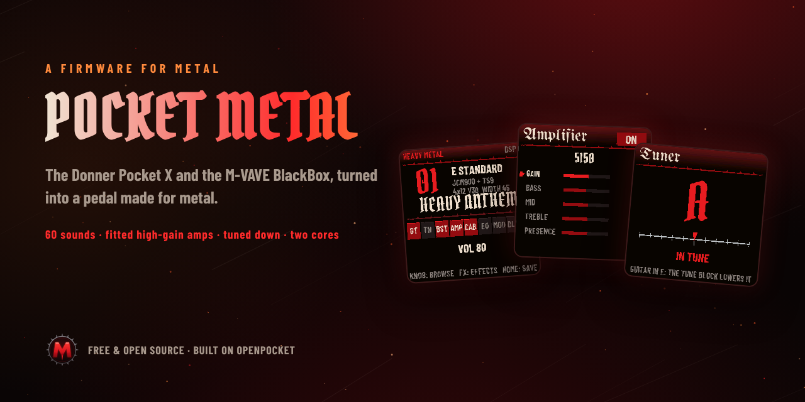
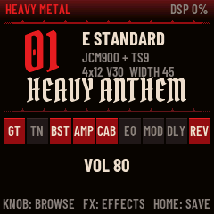
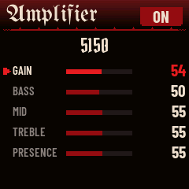
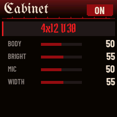
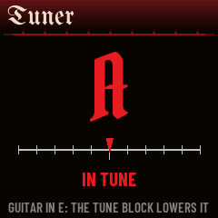

<p align="center"></p>

<p align="center">
  <a href="https://isod89.github.io/pocket-metal/"><b>Install from the browser</b></a> ·
  <a href="docs/METAL.md">The manual</a> ·
  <a href="https://github.com/isod89/pocket-metal/releases/latest">Releases</a> ·
  <a href="https://github.com/isod89/openpocket">OpenPocket</a>
</p>

# POCKET METAL

**POCKET METAL turns the Donner Pocket X and the M-VAVE BlackBox into a pedal made for one kind of music.** Sixty
sounds for every style of metal, high-gain amps fitted to captures of the real gear, down-tuning to the cent, stereo
width, and black and blood screens. It is a free, open-source firmware, built on
[OpenPocket](https://github.com/isod89/openpocket)'s base firmware, and installed from the browser in two minutes.
OpenPocket or the official firmware goes back on the same way.

<p align="center">
  
  
  
  
</p>

## What it does

- **Sixty sounds, every style.** Heavy metal and NWOBHM, glam, thrash (Bay Area and German), crossover, speed, power,
  death (old school, brutal, technical, melodic, Swedish), death-doom, black (raw, atmospheric, dissonant,
  depressive), war metal, blackgaze, doom, epic doom, funeral doom, drone, sludge, stoner, djent, thall, prog,
  neoclassical, nu metal, alternative metal, metalcore, melodic metalcore, mathcore, deathcore, grindcore, crust,
  industrial, groove, folk, Viking, gothic, symphonic, post-metal, cleans and leads. All at the same loudness.
- **Fitted amps and pedals.** Ten high-gain amps (RECTO, 6505, 5153 RED, XXX, SAVAGE, ROCKERVERB, GH100, MIG 50,
  YERASOV, JVM OD2) and five pedals (PRECISION, DS-1, RAT, OS-2, UBER METAL), fitted by a computer to captures of the
  real gear, beside OpenPocket's own eight amps and four pedals. No NAM: a few numbers each, light enough for the pedal.
- **Two cores.** The chain runs on the pedal's second core, the delay and the reverb on the first, as OpenPocket runs
  its own engine.
- **Tuned down without retuning.** DOWN TUNE takes the whole guitar from E to F# standard, or an octave down, to the
  cent, while the guitar stays in E. The same page has an octaver, a harmonizer, a whammy and a detune.
- **A gate for riffs.** It opens without a click, and holds 3 dB below its threshold and 40 ms more: a palm-muted chug
  neither chatters nor loses its next note.
- **Stereo.** WIDTH spreads the guitar's highs between the two sides; the low end stays tight in the middle.
- **MIDI**: a sound per Program Change (0 to 59), each block on or off on Control Changes 80 to 88, the tuner on 89.

## Install

1. Open **[isod89.github.io/pocket-metal](https://isod89.github.io/pocket-metal/)** in Chrome or Edge, on a computer.
2. Turn the pedal on and plug it in with a USB data cable. Press **Connect**, and allow MIDI access.
3. Press **Install POCKET METAL**. Keep the pedal plugged in for the minute or two it takes.

The page checks the package before anything is sent, and the pedal checks it again before anything is written. It
works over the official firmware, over OpenPocket, and over another firmware on OpenPocket's base. Your OpenPocket
presets, NAM models and cabinet IRs stay on the pedal.

**This version has not run on a pedal yet.** Install it on a pedal you can recover: keep your backup or the official
firmware file at hand, and please [say how it went](https://github.com/isod89/pocket-metal/issues), with the `DSP`
figure the PLAY page shows on the heaviest sounds. A BlackBox on M-VAVE's firmware V22 or later is refused, as by
OpenPocket.

## Go back

- **To OpenPocket:** open [OpenPocket's installer](https://isod89.github.io/openpocket/) and press **Back to
  OpenPocket**.
- **To the official firmware:** step 3 of the [installer page](https://isod89.github.io/pocket-metal/), with the file
  from Donner or M-VAVE.
- **A pedal that restarts in a loop:** the installer's rescue mode, or OpenPocket's
  [USB rescue](https://github.com/isod89/openpocket/blob/main/docs/RESCUE.md).

## The controls

| Control | What it does |
| --- | --- |
| Footswitches | The sound before, the sound after |
| Both footswitches | The tuner |
| The knob | Browses the sounds; **PUSH** loads the one shown |
| FX | The pages GATE, TUNE, BOOST and EQ in turn; held: the tuner |
| MOD, AMP, CAB, DLY, REV | That block's page; pressed again on it: the block on or off |
| HOME | Back to PLAY; held 0.8 s: **SAVE** |
| MASTER | The volume |

Every page, setting and sound is in **[the manual](docs/METAL.md)**.

## Build it yourself

On Windows, `BUILD.bat` (Docker Desktop and Node.js, or WSL), then `INSTALL.bat` for the installer on your computer.
On any system:

```
node tools/op.mjs build     # build/apps/metal/: the firmware and its two packages
node tools/op.mjs test      # the host tests: the engine on real DI guitar, the app in the simulator
node tools/op.mjs sim       # POCKET METAL on your computer: its screen and controls in a page, no pedal
node tools/op.mjs serve     # the installer on your computer, with the packages you built
```

The build runs JieLi's toolchain in a pinned Docker container; nothing of the official firmware is needed.
`PUBLISH.bat` puts a version on GitHub: the source, the release, and the installer page.

This repository is exported from OpenPocket (`EXPORTED.txt`), where POCKET METAL is developed beside OpenPocket's
other firmwares. Changes to the base firmware and to the engine belong there.

## Credits

POCKET METAL is built on **[OpenPocket](https://github.com/isod89/openpocket)**: its engine, its fitted models, its
base firmware, build, update loader, simulator and installer. The base firmware shared by OpenPocket and its
alternative firmwares is by **[VinSpee](https://github.com/VinSpee)** with OpenPocket. The metal amps and pedals are
fitted to captures from the Neural Amp Modeler community
([pelennor2170/NAM_models](https://github.com/pelennor2170/NAM_models)). The chip support and the update loader come
from [felucca-bsp](https://github.com/hugelton/felucca-bsp) and [Felucca](https://github.com/hugelton/Felucca)
(Hügelton Instruments). The screen fonts are rendered from Pirata One, UnifrakturMaguntia and Barlow Condensed (SIL
OFL 1.1). Everything is listed in [NOTICE.md](NOTICE.md).

GPL-3.0 ([LICENSE](LICENSE)). An independent project, not affiliated with Donner, M-VAVE, or the makers of the amps
and pedals named here.
